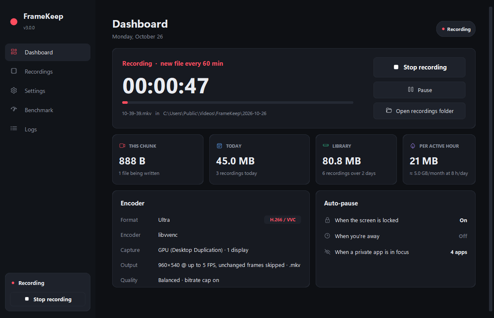
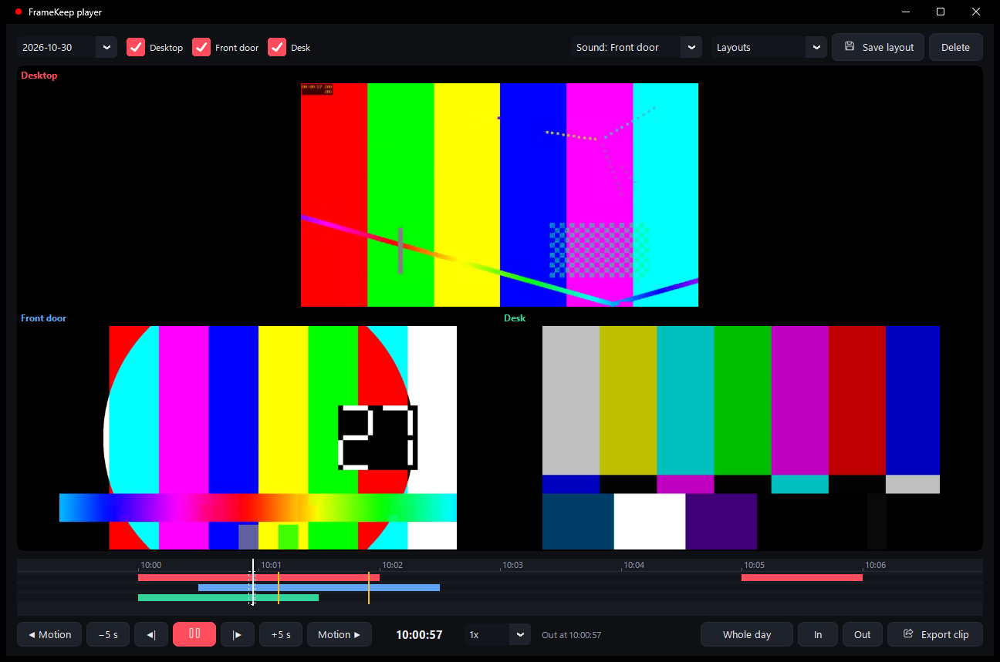
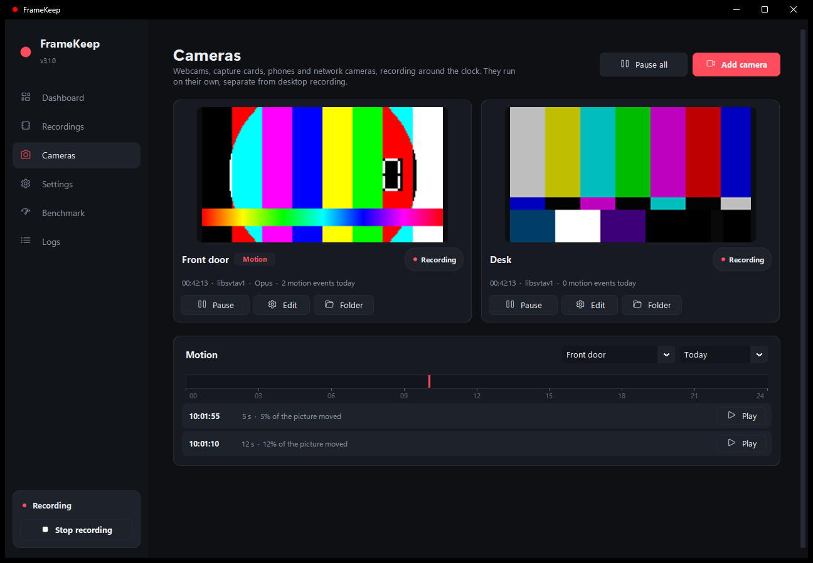
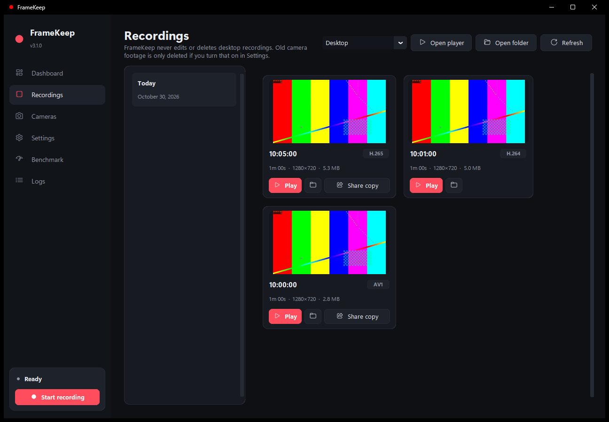
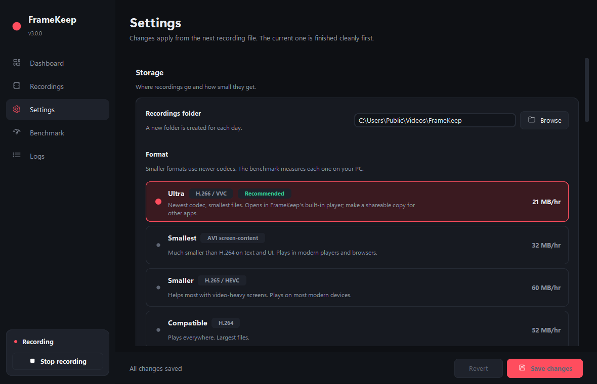
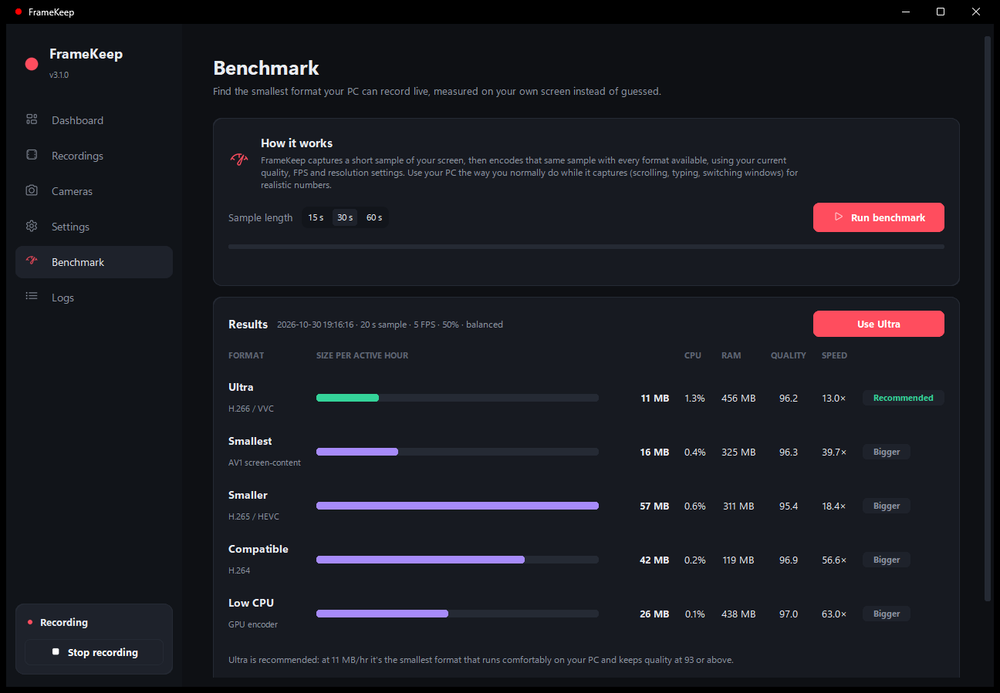
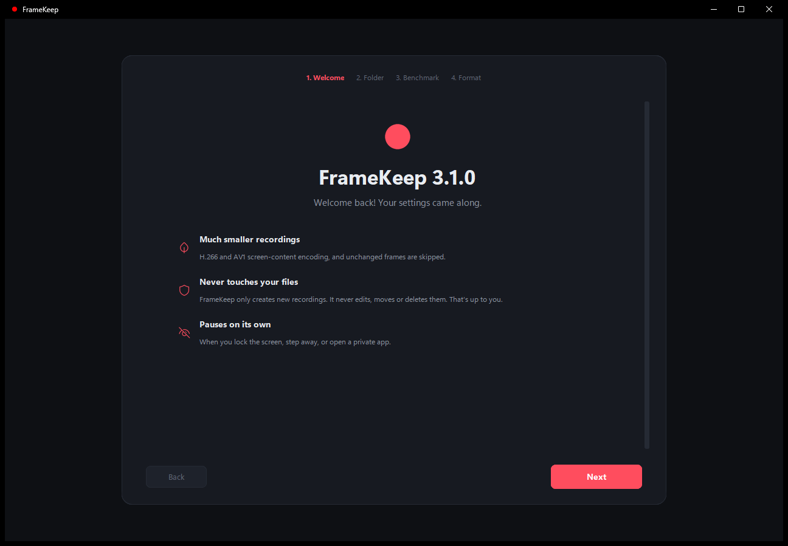

# FrameKeep 3.1

###### (C) 2025 Pure Tech. Licensed under the MIT License, see [LICENSE](LICENSE)

**A low-power, tiny-file, non-invasive screen and camera recorder for all the moments you wish you had saved.**



| Player | Cameras |
|---|---|
|  |  |
| **Recordings** | **Settings** |
|  |  |
| **Benchmark** | **First run** |
|  |  |

> ### Just want to use it? Get the `.exe`
> Download **`FrameKeep.exe`** from the [Releases page](../../releases/latest). It's one portable file with
> everything inside it, FFmpeg included. No Python, no installer, no dependencies.
>
> **If you're using the `.exe`, you can delete everything else in this repo and keep only `FrameKeep.exe`.**
> Put it wherever you like and double-click it.

---

## What's new in 3.1

A lighter FrameKeep that also watches your cameras. Every number below is measured on the same PC, and the full
tables (and how to reproduce them) are in [docs/perf](docs/perf/README.md).

- **Cameras.** Turn your webcams, capture cards, phones and network (RTSP) cameras into a recording station, right
  inside FrameKeep. Each camera records around the clock, with no gap between files, and marks motion on a
  timeline so you can jump straight to it. Cameras run separately from desktop recording, so you can pause your
  own webcam for a call from the tray or a hotkey, or have it pause by itself while Zoom is open. See
  [Cameras](#cameras). Measured on a 720p webcam sample at 15 FPS: 86 MB per hour in AV1, 2.2% of the PC's CPU
  and 311 MB of memory per camera, and three cameras at once kept real time even on 2 CPU cores (on a still scene;
  with constant movement in view, 2 cores fell about 5 s behind per minute).

- **The FrameKeep player.** Play now opens FrameKeep's own player instead of ffplay: a whole day as one timeline
  across files, the desktop and up to three cameras side by side in sync, motion marks, 0.25x to 16x, frame stepping
  and lossless clip export. Against ffplay on 8 test files it used less or equal CPU on all 8 (H.266 at 1080p: 52%
  of a core instead of 108%), less memory on 7 and seeked faster on 6. See [The FrameKeep player](#the-framekeep-player).
- **A native tray icon.** Pure Tech's own tray shows motion and problems on the icon, has notifications with buttons
  (Play on a motion alert) and a dark menu, and FrameKeep commits 16% less memory in the tray with it (19.0 MB
  instead of 22.6 MB).

- **The app itself is far lighter.** In the tray it now holds 38 MB in RAM instead of 68 MB and commits 21 MB
  instead of 520 MB, and it wakes up 3 times a second instead of 90. The window is only built while it's open:
  closing it to the tray frees it, and starting with Windows never loads it at all.
- **Less memory while recording:** the encoder uses 24% less for H.264, 23% less for AV1 and 11% less for H.266,
  does 3-8% less work, and H.264/AV1 files came out 2-3% smaller at the same quality.
- **H.266 recordings now play back with correct timing.** 3.0's Ultra files could show frames at the wrong moment
  after a still stretch; the bundled FFmpeg now includes a fix.
- **Instant auto-pause.** Locking the PC or bringing a private app to the front is reported by Windows the moment
  it happens, with no polling.
- **Desktop audio (optional, off by default).** Record what your PC plays into the same file: Opus (the smallest)
  or AAC (plays everywhere), with the bitrate set by the quality level. Silence costs about 1 kbps, switching
  headphones or speakers is followed in the same file, and you can leave apps out (for example Discord). See
  [Desktop audio](#desktop-audio).
- **"Using now" on the dashboard** shows FrameKeep's and FFmpeg's memory and CPU live, and the Benchmark now
  measures each format's memory too.

## What's new in 3.0

- **H.266 / VVC recording.** The newest video codec, encoded live. On desktop content it's **about 70% smaller than
  v2's encoding at the same visual quality** ([measurements below](#how-small)).
- **AV1 with screen-content coding** (palette mode and intra block copy, tools built for text and UI), plus
  H.265 and GPU encoders (NVIDIA / Intel / AMD).
- **One pass, straight to the final file.** v2 recorded with OpenH264 and then re-encoded everything with FFmpeg.
  3.0 captures and encodes once, so there's no second encode, no temporary MKV and no conversion step.
- **A still screen costs almost nothing.** Unchanged frames are skipped, so reading, idling or watching a static page
  barely grows the file.
- **Smart auto-pause.** Pauses when you lock the screen, step away, or bring a private app (password manager,
  banking) to the front. Resumes on its own.
- **A real app.** Dashboard, recordings browser with thumbnails, settings with no JSON editing, a built-in benchmark,
  live logs and a first-run wizard. The tray icon still works exactly like before.
- **Multi-monitor.** Record one, some or all displays.
- **Global hotkeys** (`Ctrl+Alt+F9` start/stop, `Ctrl+Alt+F10` pause), **Start with Windows**, and a one-file `.exe`.
- **Your choice of file type.** MP4, MKV or WebM, with any format that fits in it.
- **Crash-safe files.** Recordings are written in 5-second pieces, so even if the PC loses power the file plays up to
  the last few seconds.
- **Correct timing.** v2 played back too fast; a 3.0 hour plays back as an hour.

### FrameKeep never touches your recordings
FrameKeep only ever **creates new files**, a new one every hour by default. It never edits, converts, moves or deletes
an existing desktop recording. Deleting old recordings is up to you, whenever you like, in Explorer. Even the
"Share copy" button writes a *new* file next to the original and leaves the original alone.

The one exception is opt-in and only for cameras, which record around the clock: **Settings > Disk space > Delete old
camera footage** (off by default) removes camera files older than the days you set, keeping footage with motion
longer. FrameKeep also warns you when its recordings pass a size you choose (100 GB by default).

---

## How small?

Measured with FrameKeep's own **Benchmark** page on a 30-second desktop sample (code editor, terminal and a web app),
1080p downscaled to 960×540 at 5 FPS, *Balanced* quality, bitrate cap on, i5-12600K:

| Format | Codec | Size per hour of screen activity | CPU (whole PC) | Quality (VMAF) |
|---|---|---|---|---|
| **Ultra** | H.266 / VVC | **21 MB** | 2.7% | 97.0 |
| Smallest | AV1 screen-content (SVT-AV1) | 32 MB | 1.0% | 97.4 |
| Compatible | H.264 (tuned x264) | 53 MB | 0.7% | 96.8 |
| Smaller | H.265 / HEVC | 61 MB | 1.1% | 96.8 |
| Low CPU | AV1 on an NVIDIA GPU | 69 MB | 0.6% | 97.5 |
| *v2 encoding, for reference* | *H.264 (x264 fast, CRF 23)* | *74 MB* | | *97.0* |

VMAF scores quality from 0 to 100. Above ~93, most people can't tell the result from the original.

Some things to keep in mind:
- **"Per hour of activity" is the worst case for that content.** Idle time, a locked screen and auto-paused time cost
  close to nothing, so a real 8-hour day usually lands well under 8× these numbers.
- **Your numbers will differ.** Fast-moving content (games, video) needs far more data than text and UI. The bitrate
  cap stops it from ballooning. Run the Benchmark on your own PC: it measures every format on your screen and
  recommends the smallest one your CPU handles comfortably.
- H.265 isn't consistently smaller than tuned H.264 on screen content, which is why Ultra and Smallest are the
  recommended formats.

### Playing H.266 files
H.266 is new, so Windows' built-in player and browsers can't open it yet. FrameKeep handles this for you:
- **Play** opens every format, H.266 included, in the [FrameKeep player](#the-framekeep-player).
- **Share copy** makes a new H.264 file that plays anywhere, for sending to someone.
- Other players built on FFmpeg 7.1 or newer (recent mpv builds, for example) also play H.266.

If you need files that open everywhere with no fuss, pick **Compatible** (H.264).

---

## Requirements

- Windows 10 or 11 (64-bit)
- Any quad-core CPU from roughly the last 10 years. Dual-cores over 2 GHz work with the lighter formats.
- 4 GB RAM (8 GB recommended for Ultra). While recording, FrameKeep itself uses about 40 MB and the FFmpeg encoder
  roughly 250 MB (H.264), 430 MB (AV1) or 560 MB (H.266), measured as private memory on a 1080p display
  ([details](docs/perf/README.md)). Desktop audio, if you turn it on, adds about 21 MB and well under 1% CPU.
  Each camera at 720p 15 FPS in AV1 adds about 310 MB and 2% CPU (of a 16-thread PC); a network camera kept as-is
  about 85 MB and almost no CPU.
  The dashboard's **Using now** tile shows your own numbers.
- Any HDD or SSD
- A GPU isn't required. If you have one, FrameKeep uses it to capture the screen (Desktop Duplication) and offers
  its hardware encoder as the **Low CPU** format.

The Benchmark tells you which formats your PC can record live. On slower CPUs it will recommend AV1 or H.264
instead of H.266.

## Install

### Option 1: the `.exe` (recommended)
1. Download `FrameKeep.exe` from [Releases](../../releases/latest).
2. Double-click it. The welcome wizard asks where to save recordings, runs the 30-second benchmark and lets you pick a format.
3. That's it. FrameKeep lives in the system tray (bottom-right, near the clock). Drag its icon out of the overflow
   arrow so it's always visible.

Windows SmartScreen may warn about an unrecognized app the first time. Click **More info → Run anyway**.

### Option 2: run from source
1. Install [Python](https://www.python.org/downloads/) 3.10 or newer.
2. Download this repo (**Code → Download ZIP**) and extract it.
3. Double-click **`dependencies.bat`**. It installs the three Python packages and downloads FFmpeg (~21 MB, checksum-verified)
   into the `ffmpeg` folder. Run it again after updating.
4. Double-click **`FrameKeep.pyw`** to start without a console window, or run it from a terminal:
   ```
   python -m framekeep
   ```

If the `ffmpeg` folder is missing (or its build lacks H.266) and an FFmpeg with `libvvenc` is on your PATH
(for example `winget install Gyan.FFmpeg`), FrameKeep finds and uses that one automatically.

---

## Using FrameKeep

| To… | Do this |
|---|---|
| Start / stop recording | **Start recording** on the dashboard, the tray menu, or `Ctrl+Alt+F9` |
| Pause / resume | **Pause** on the dashboard, the tray menu, or `Ctrl+Alt+F10` |
| Open the window | Left-click the tray icon. Closing the window just hides it to the tray. |
| Quit | Right-click the tray icon → **Quit**. The current file is finished cleanly first. |
| Find a moment | **Recordings** page: pick a day, see thumbnails, hit **Play** (or **Open player** for the whole day) |
| Add a camera | **Cameras** page → **Add camera** |
| Pause a camera (free your webcam) | Its **Pause** button, the tray's **Cameras** menu, or the camera hotkey you set |
| Jump to motion | **Cameras** page: click a mark on the timeline, or **Play** next to an event or on a motion notification |
| Save a moment | In the player: **In**, **Out**, then **Export clip** |
| Free up space | Delete old day folders in Explorer. FrameKeep never deletes desktop recordings; old camera footage only if you turn that on. |

**Tray icon:** the center is red = recording, yellow = paused, purple = auto-paused, gray = ready. A blue corner dot
means a camera sees motion right now; an orange badge means a camera can't record or recordings are past your
disk-space warning. Hover over it for the details. The menu follows Windows' dark or light mode, and notifications
have buttons (for example **Play** on a motion alert).

### The FrameKeep player

**Play** anywhere in FrameKeep opens its own player (**Open player** on the Recordings page or in the tray opens it
on its own). It plays a whole day as one timeline, crossing from file to file without a pause, and it plays every
format FrameKeep records, H.266 included.

- **Side by side:** tick up to four sources (the desktop and any cameras). They play in sync on the wall clock, with
  the sound from the one you pick. **Save layout** keeps a combination for later.
- **Time bar:** one colored lane per source shows when it recorded; yellow marks are motion. Click or drag to jump,
  **Whole day** / **Fit to footage** zooms. Stretches that weren't recorded are skipped.
- **Speed and stepping:** 0.25x to 16x (sound up to 2x), frame by frame back and forward, and previous/next motion.
- **Clips:** set **In** and **Out**, then **Export clip**. The recording is copied as-is, so the clip keeps full quality
  and saves in a moment. Copies have to start on a keyframe, so before saving it shows exactly where the clip will
  start and end. Clips go to `<your folder>\Clips\` by default and never change the recordings themselves.

| Key | Does |
|---|---|
| `Space` | Play / pause |
| `←` / `→` | 5 s back / forward |
| `Shift+←` / `Shift+→` (or `,` / `.`) | One frame back / forward |
| `[` / `]` | Slower / faster |
| `M` / `Shift+M` | Next / previous motion |
| `I` / `O` / `E` | Set in / set out / export clip |
| `G` | Skip a stretch that wasn't recorded |
| `Esc` | Close the player |

Prefer another player? Set **Player** to **Windows default app** in Settings.

**Files:** recordings are saved as `<your folder>\YYYY-MM-DD\HH-MM-SS.mp4`, one file per hour by default.
Pausing finishes the current file, and resuming starts a new one named after its start time. With several displays
selected, each display gets its own file (`HH-MM-SS_mon2.mp4`).

**File type** (Settings → Storage) picks the container, separately from the codec:

| File type | Works with | Notes |
|---|---|---|
| **MP4** (default) | H.264, H.265, AV1, H.266 | Opens almost everywhere |
| **MKV** | H.264, H.265, AV1, H.266 | Works with everything; a favorite for archiving |
| **WebM** | AV1 (Smallest, or Low CPU on an AV1 GPU) | Open web format. With any other codec, FrameKeep saves MKV instead. |

All three are written so a file still plays if FrameKeep or the PC dies mid-recording. The file type doesn't change
the file size noticeably; the codec does that.

### Auto-pause
| Trigger | Default | Setting |
|---|---|---|
| Screen locked (Win+L, sleep, UAC prompts) | On | Pause when the screen is locked |
| No keyboard/mouse input | 5 minutes | Pause when you're away (0 = never) |
| A private app is the active window | KeePass, KeePassXC, 1Password, Bitwarden | Private apps, one program name per line |

Lock and private-app pauses happen the moment Windows reports the change, and recording resumes automatically when the reason goes away (within about half a second for idle pauses).

### Cameras
Add cameras on the **Cameras** page. Each one gets a live tile, its own folder
(`<recordings>\Cameras\<camera name>\YYYY-MM-DD\HH-MM-SS.mp4`, or another drive under Settings > Disk space) and
today's motion on a timeline.

| Source | How to add it |
|---|---|
| USB or built-in webcam, HDMI capture card | Pick it from the list (anything Windows sees as a camera) |
| Phone | As a webcam with an app like Iriun or DroidCam (it shows up in the list), or by its network address |
| Network / IP camera | Its RTSP address (`rtsp://…`) or an HTTP MJPEG address, plus its login |

- **Recording:** continuous, at up to 720p and 15 FPS by default (both adjustable per camera). One FFmpeg runs per
  camera for hours and starts a new file on the hour (or your chunk length) without stopping, so there's no gap
  between files. Webcams are lightly denoised before encoding, which made files 6% smaller for the same CPU on a
  webcam test.
- **Format:** the same as desktop recordings (Ultra means AV1 here: H.266 can't keep up with camera video), or any
  format per camera. **Smallest (AV1) suits cameras best**: at the same quality it was 2.8× smaller than H.265 and
  10× smaller than H.264 on a webcam test. Network cameras keep their own stream by default (next to no CPU);
  switch off *Keep the camera's own stream* to re-encode it smaller (to 3% of the size in a test, for about 2% CPU).
- **Motion:** marked on a timeline per day; click a mark or an event's **Play** to watch from just before it. Set the
  sensitivity per camera, and optionally get a Windows notification (at most once a minute).
- **Sound:** off by default. A webcam's own microphone is picked automatically; a network camera's audio comes with
  its stream. Opus or AAC, following the same rule and bitrates as desktop audio.
- **Date and time in the picture:** optional per camera (burned in, so any player shows it).
- **Save space when nothing moves:** optional; drops near-identical frames (at least one a second stays). It saved
  11% on a still webcam scene.
- **Your own webcam:** a webcam can only be used by one program at a time. Pause it from its tile, the tray's
  **Cameras** menu, or the camera hotkey (Settings > General), or list apps (for example `zoom.exe`) in *Pause while
  these apps are open* and FrameKeep frees the camera while they run.
- **Independent of desktop recording:** cameras keep recording when the PC is locked or idle, or a private app is
  open, and desktop Start/Stop doesn't touch them.
- **Unplugged or offline cameras** show *Not connected* and reconnect by themselves, backing off up to a minute
  between tries. A camera another app is using shows *In use by another app*.
- **Network passwords** are stored encrypted for your Windows account (DPAPI) and hidden in logs and messages.

---

## Settings

Everything is in the **Settings** page and applies from the next recording file. You can still edit
`%APPDATA%\FrameKeepOS\config.json` by hand if you prefer, but restart FrameKeep afterwards.
Your v2 config is upgraded automatically: folder, FPS, downscale and chunk length are kept, and your CRF becomes a quality level.

| Key | Default | What it does |
|---|---|---|
| `log_root` | *(chosen in the wizard)* | Recordings folder. A sub-folder is made per day. |
| `preset` | `smallest` | `ultra` (H.266), `smallest` (AV1), `smaller` (H.265), `compatible` (H.264), `lowcpu` (GPU). Falls back automatically if your PC can't run it. |
| `quality` | `balanced` | `high`, `balanced`, `saver`, `max_saver` |
| `container` | `mp4` | File type: `mp4`, `mkv` or `webm`. WebM holds AV1 only; other formats are saved as MKV. |
| `bitrate_cap` | `true` | Caps bitrate so fullscreen video/games can't balloon a file |
| `fps` | `5` | Maximum frames per second (1–30). Unchanged frames are skipped anyway. |
| `downscale_factor` | `0.5` | 0.5 turns 1080p into 540p, 1440p into 720p, 4K into 1080p |
| `chunk_minutes` | `60` | Minutes per file |
| `monitors` | `["primary"]` | `"primary"`, `"all"`, or display names like `"\\\\.\\DISPLAY2"` |
| `capture_backend` | `auto` | `auto`, `ddagrab` (GPU Desktop Duplication), `gdigrab` (GDI) |
| `drop_duplicates` | `true` | Skip frames where nothing changed |
| `draw_mouse` | `true` | Show the cursor |
| `crop_taskbar` | `false` | Record the work area only |
| `grayscale` | `false` | Drop color for the smallest text-only archive |
| `audio` | `false` | Also record desktop audio (what your PC plays) into the same file |
| `audio_codec` | `auto` | `auto` (AAC with Compatible/H.264, Opus with everything else), `opus` or `aac`. WebM always uses Opus. |
| `audio_exclude_apps` | *(none)* | `.exe`s whose sound is left out, for example `discord.exe` (see [Desktop audio](#desktop-audio)) |
| `pause_on_lock` | `true` | Auto-pause on lock |
| `idle_pause_minutes` | `5` | Auto-pause after this many idle minutes (0 = never) |
| `private_apps` | password managers | Auto-pause while one of these `.exe`s is in front |
| `hotkey_toggle` / `hotkey_pause` | `ctrl+alt+f9` / `ctrl+alt+f10` | Global hotkeys |
| `hotkey_cameras` | *(none)* | Pauses or resumes the cameras set to follow it |
| `cameras` | *(none)* | Your cameras, as set up on the Cameras page (name, source, resolution, FPS, format, sound, motion, pausing) |
| `camera_root` | *(automatic)* | Camera recordings folder. Empty: a `Cameras` folder inside `log_root`. |
| `storage_warn_gb` | `100` | Warn when desktop and camera recordings together pass this many GB (0 = never) |
| `camera_cleanup` | `false` | Delete old camera footage (never desktop recordings) |
| `camera_keep_days` / `camera_keep_motion_days` | `7` / `30` | With cleanup on: how long camera footage without / with motion is kept |
| `record_on_launch` | `false` | Start recording as soon as FrameKeep opens |
| `start_with_windows` | `false` | Launch hidden in the tray when you sign in |
| `player` | `framekeep` | `framekeep` (the FrameKeep player) or `system` (Windows' default app) |
| `player_layouts` | *(none)* | Layouts saved in the player: name, sources and which one plays sound |
| `ffmpeg_path` | *(automatic)* | Use a specific `ffmpeg.exe` |

### Quality levels
Each level maps to the right value for each codec (CRF for x264/x265/AV1, QP for H.266). *Balanced* is tuned
to look the same as v2's default CRF 23. *High* keeps more detail in small text, while *Saver* and *Max saver*
trade sharpness for space. With desktop audio on, the level also sets the audio bitrate:

| | High | Balanced | Saver | Max saver |
|---|---|---|---|---|
| Opus | 96 kbps | 48 kbps | 32 kbps | 24 kbps |
| AAC | 160 kbps | 128 kbps | 96 kbps | 64 kbps |

Opus is variable bitrate: busy sound can take more than this, quiet passages less, and silence about 1 kbps.

### Desktop audio
Off by default. Turn it on in **Settings > Audio** (or in the setup wizard) to record what your PC plays (videos,
calls, games) into the same file as the video.

- **Format:** Opus, the smallest, with every format except Compatible (H.264), which gets AAC so the file plays
  everywhere. You can choose either one yourself.
- **Switching headphones or speakers** mid-recording is followed within half a second, in the same file.
- **Leave out apps:** sound from the `.exe`s you list isn't recorded. On Windows 11, one listed app at a time is
  filtered out of the mix. On Windows 10, or when two listed apps play at once, the audio goes silent while they play.
- With more than one display, the sound goes in the first display's file.
- Auto-pause and pausing stop the audio too; the private-app pause covers sound as well as the picture.

---

## Command line

```
python -m framekeep                 open FrameKeep (same as FrameKeep.pyw / FrameKeep.exe)
python -m framekeep --minimized     start hidden in the tray
python -m framekeep --no-gui        tray + console only, like v2
python -m framekeep --benchmark 30  measure every format on your screen and print a table
python -m framekeep --list-monitors show detected displays
python -m framekeep --version       print the version
```

## Building the `.exe` yourself

```
python -m pip install -r requirements.txt pyinstaller
python tools/fetch_ffmpeg.py
pyinstaller framekeep.spec
```
The result is `dist\FrameKeep.exe`. Pushing a `v*` tag runs the same build on GitHub Actions and attaches the
`.exe` to a release ([.github/workflows/release.yml](.github/workflows/release.yml)).

The bundled FFmpeg is a minimal build containing only what FrameKeep uses, made by
[tools/build_ffmpeg.sh](tools/build_ffmpeg.sh) in an [MSYS2](https://www.msys2.org/) UCRT64 shell
(`bash tools/build_ffmpeg.sh --deps`) or by the manually run [FFmpeg workflow](.github/workflows/ffmpeg.yml).
Install a zip you built yourself with `python tools/fetch_ffmpeg.py --zip <path>`.

Run the tests with `python -m pytest`.

To measure a change, `tools/measure.py` compares two versions on the same synthetic desktop recording (file size,
VMAF, CPU, memory, timing) and `tools/measure_ab.py` alternates them for live CPU. `tools/measure_audio.py` measures
what desktop audio costs. See [docs/perf](docs/perf/README.md).

---

## How it works

```
 screen ──► ddagrab (GPU)   ──► skip unchanged ──► downscale ──► H.266 / AV1 / H.264 ──► MP4 / MKV / WebM
            or gdigrab (GDI)     frames (mpdecimate)                 (one encode)            (written once)
```

- **One FFmpeg process per display per file.** Python is just the conductor: it starts FFmpeg, rolls to a new file
  every `chunk_minutes`, and stops it cleanly (it sends `q`, so FFmpeg finishes the file properly).
- **Desktop audio** (when on) is captured by FrameKeep itself with Windows' WASAPI loopback, encoded by a second,
  tiny FFmpeg, and joined with the video by a third that only copies both into the file. Both are stamped on the
  same clock, so they stay in sync. They're separate because one FFmpeg holds every input back to its slowest
  output, and the video encoder works several seconds behind real time; this way the held-back audio waits already
  compressed (a few KB per second) and none of it is lost when a file is stopped.
- **Cameras** are one FFmpeg each, supervised separately so one camera failing never touches the others or the
  desktop. FFmpeg's segment muxer starts each new file on the clock without stopping the capture. A second, tiny
  output (192×108, 4 frames a second) feeds FrameKeep's motion detection and the live tiles: comparing a coarse grid
  of it against a slowly learned background costs about 0.05% of one CPU core per camera. Network streams that are
  kept as-is only have their keyframes decoded for that.
- **Variable frame rate.** Frames are only produced when the screen changes, timestamped as they're captured, so
  playback timing is exact. At least one frame is kept every 10 seconds so durations stay accurate.
- **Long keyframe interval** (once per minute of activity). Screens change slowly, so this saves a lot of space.
- **Crash-safe containers.** MP4 is written as fragmented MP4 with a fragment every 5 seconds; MKV and WebM write a
  cluster every 5 seconds. If FrameKeep or the PC dies, the file still plays. Only the last few seconds the encoder
  was still working on are lost (measured: a hard kill 30 s in keeps about 15 to 20 s in every container).
- **Fallbacks everywhere.** If GPU capture fails it switches to GDI. If a format's encoder isn't available it falls back
  to the next smallest. If FFmpeg crashes, a new file starts a moment later. The old file is never reopened.
- **Never overwrites.** FFmpeg runs with `-n` and every file name is checked first, so an existing file can't be clobbered.

## FAQ

**My recordings won't open in Windows' Movies & TV / Media Player.**
They're probably H.266 (Ultra). Use **Play** in FrameKeep (the FrameKeep player), a recent mpv build, or
**Share copy** for an H.264 version. H.265 files need Microsoft's HEVC extension or the FrameKeep player.

**Windows Security flagged ffmpeg.exe or FrameKeep.exe.**
They're unsigned, so Windows may be cautious the first time. Allow them in Windows Security. FrameKeep never uploads
anything and has no telemetry. The only network connections it makes are to network cameras you add yourself.

**Does it record audio?** Optionally: desktop audio (Settings > Audio) and each camera's microphone, both off by
default.

**Can two programs use my webcam at once?** No, Windows gives a webcam to one program at a time. Pause the camera in
FrameKeep (tile, tray or camera hotkey) or list your video-call apps under *Pause while these apps are open*.

**Why 5 FPS?** It's plenty to see what happened, and the file stays tiny. Raise it in Settings if you want smoother playback.

**Why is there a FrameKeep shortcut in my Start menu?** Windows only shows notifications with buttons for apps
that have one, so FrameKeep adds it (for your account only) the first time it shows a notification. It just opens
FrameKeep.

**Where are the logs and settings?** `%APPDATA%\FrameKeepOS\`, which also holds thumbnails and the benchmark result.
None of it is stored next to your recordings.

**Something went wrong.** Check the **Logs** page, then [open an issue](../../issues) with what it says.

---

## Dependencies explained

- **Python** (source version only) is the language FrameKeep is written in. The `.exe` has Python built in.
- **CustomTkinter** draws the modern dark interface on top of Python's built-in tkinter. It's only loaded while the
  window is open; in the tray the app itself uses under 40 MB of RAM.
- **puretech-tray** ([Pure Tech's own](https://github.com/puretechteam/puretech-tray), no dependencies) puts the
  icon in the system tray: the live status icon, the dark or light menu and notifications with buttons. It
  replaced pystray in 3.1.
- **puretech-player** ([Pure Tech's own](https://github.com/puretechteam/puretech-player)) is the engine of the
  FrameKeep player: FFmpeg decodes, Direct3D 11 draws and Windows' audio API plays the sound. It replaced `ffplay`
  in 3.1.
- **Pillow** draws the tray icon, the interface icons and the thumbnails.
- **FFmpeg** does the capturing and encoding: GPU/GDI screen capture, H.266 (VVenC), AV1 (SVT-AV1, libaom),
  H.264 (x264), H.265 (x265), the GPU encoders, and Opus/AAC for desktop audio. It also makes thumbnails, decodes
  recordings for the FrameKeep player and reads the cameras (DirectShow, RTSP, HTTP). FrameKeep captures desktop audio
  itself through Windows' audio API, with no extra package. FFmpeg runs only on your PC and connects to nothing but
  the network cameras you add.

Gone since v2: OpenCV, NumPy, mss, pywin32, pythonnet and OpenH264. FFmpeg now handles everything they did, and
does it with fewer resources.

## Third-party software

FrameKeep uses **FFmpeg** 9.0.2 ([source](https://ffmpeg.org/releases/ffmpeg-9.0.2.tar.xz)), built under GPLv3
by [tools/build_ffmpeg.sh](tools/build_ffmpeg.sh) with x264, x265, SVT-AV1, libaom, dav1d, VVenC, libvmaf, libopus,
FreeType, HarfBuzz
and Intel VPL, each under its own license. FrameKeep's one change to FFmpeg's own code, a fix for H.266 timestamps,
is in [tools/patches](tools/patches). FFmpeg is not part of this project's code and isn't covered by
FrameKeep's MIT License: FrameKeep runs it as a separate program, and `FrameKeep.exe` carries a copy of it under
FFmpeg's own GPLv3 terms. See `ffmpeg/LICENSE` and `ffmpeg/BUILDINFO.txt` (exact configure line and library versions)
after running `tools/fetch_ffmpeg.py`.

Python packages: CustomTkinter (MIT), Pillow (MIT-CMU), puretech-tray and puretech-player (MIT, Pure Tech).

Icons are from Windows' built-in Segoe Fluent Icons / Segoe MDL2 Assets fonts.
